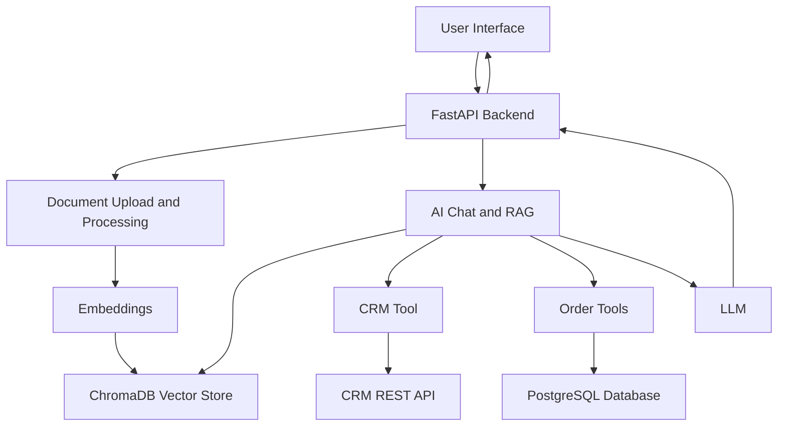

# Integrated AI Assistant


## 1. Project Purpose


The Integrated AI Assistant is an AI-powered application that helps users interact with uploaded documents, retrieve customer and order information, and generate email drafts.


The application combines Retrieval-Augmented Generation (RAG), document embeddings, a vector database, CRM integration, PostgreSQL and an LLM.


### Main Features


- Upload PDF and DOCX documents.

- Extract text and split it into smaller chunks.

- Generate text embeddings.

- Store and retrieve document information using ChromaDB.

- Ask questions about uploaded documents.

- Retrieve customer information through a CRM API.

- Retrieve order status and customer order history from PostgreSQL.

- Generate email drafts using the AI assistant.

- Handle unsupported questions with appropriate refusals.


## 2. Technologies Used


| Technology | Purpose |

|---|---|

| Python | Backend programming |

| FastAPI | REST API framework |

| ChromaDB | Vector database |

| Embeddings | Convert text into vectors |

| PostgreSQL | Store order information |

| psycopg2 | PostgreSQL connection |

| Requests | CRM API integration |

| LLM | AI responses |

| HTML, CSS, JavaScript | User interface, if configured separately |


## 3. Project Architecture





### Architecture Explanation


1\. The user interacts with the application through the UI.

2\. FastAPI receives user requests.

3\. Uploaded documents are parsed and divided into chunks.

4\. Embeddings are generated and stored in ChromaDB.

5\. The RAG system retrieves relevant document information.

6\. CRM tools retrieve customer information through REST APIs.

7\. Order tools retrieve order information from PostgreSQL.

8\. The LLM generates responses and email drafts.

9\. FastAPI returns the result to the user.


## 4. Project Folder Structure


```text

week4 first half/

│

├── app/

│   ├── main.py

│   ├── chat.py

│   ├── crm.py

│   ├── crm_mock.py

│   │

│   ├── database/

│   │   └── chroma.py

│   │

│   ├── models/

│   │   └── schemas.py

│   │

│   ├── routes/

│   │   └── documents.py

│   │

│   └── services/

│       ├── chunker.py

│       ├── embeddings.py

│       ├── llm.py

│       ├── order_db.py

│       ├── order_tools.py

│       ├── parser.py

│       └── vector_store.py

│

├── chroma_db/

├── tests/

├── uploads/

├── README.md

└── test_llm.py

```


## 5. Setup Instructions


### Prerequisites


- Python 3.12

- PostgreSQL

- Git

- VS Code


### Step 1: Clone the repository


```bash

git clone YOUR_GITHUB_REPOSITORY_URL

cd YOUR_PROJECT_FOLDER

```


### Step 2: Create a virtual environment


```bash

python -m venv venv

```


Activate it on Windows:


```powershell

.\\venv\\Scripts\\Activate.ps1

```


### Step 3: Install dependencies


```bash

pip install fastapi uvicorn python-multipart

pip install chromadb sentence-transformers

pip install psycopg2-binary requests

pip install pypdf python-docx python-dotenv

```


Install any additional LLM dependencies required by the project.


### Step 4: Configure environment variables


Create a `.env` file in the project root.


Example:


```env

DB_HOST=127.0.0.1

DB_NAME=week4_orders

DB_USER=assistant_reader

DB_PASSWORD=YOUR_DATABASE_PASSWORD

DB_PORT=5432


CRM_BASE_URL=http://127.0.0.1:8001

```


Never upload `.env` or real credentials to GitHub.


The application code must be configured to read these variables before using this configuration.


### Step 5: Start the application


```bash

uvicorn app.main:app --reload

```


The FastAPI backend runs at:


http://127.0.0.1:8000


API documentation:


http://127.0.0.1:8000/docs


## 6. API Endpoints


| Method | Endpoint | Purpose |

|---|---|---|

| GET | `/` | Check application status |

| POST | `/documents` | Upload a document |

| GET | `/documents` | List uploaded documents |

| POST | `/chat` | Ask questions using the AI assistant |


## 7. Example Questions


### Document Q&A


- What are the concepts covered in Week 3?

- Explain neural networks.

- What is backpropagation?


### CRM Tool


- What is the plan of customer 3?

- Get customer details for customer 3.


### PostgreSQL Order Tool


- What is the status of order 1048?

- Show all orders for customer 3.


### Email Draft


- Draft an email to the customer about the order delay.


### Refusal


- Ask a question unrelated to the uploaded documents or available tools.


The assistant should refuse or explain when it does not have sufficient information.


## 8. Testing


Run the project tests using:


```bash

pytest -v

```


## 9. Demo


The project demonstration covers:


1\. Upload a document and ask a question.

2\. Demonstrate a CRM or PostgreSQL tool call.

3\. Ask an unsupported question and show the refusal.

4\. Generate an email draft.


## 10. Future Improvements


- Add authentication and authorization.

- Improve error handling and logging.

- Add more CRM integrations.

- Improve document retrieval accuracy.

- Deploy the application to a cloud platform.


---


**Project:** Integrated AI Assistant  

**Backend:** FastAPI  

**Database:** ChromaDB and PostgreSQL  

**Language:** Python


